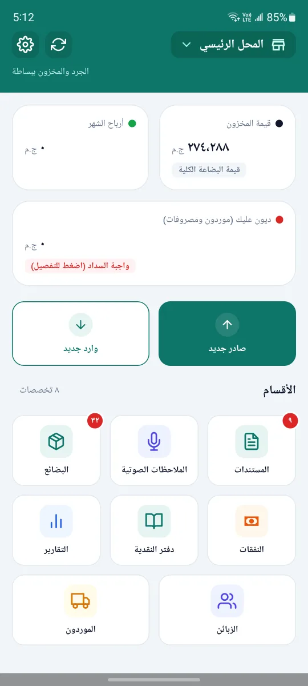
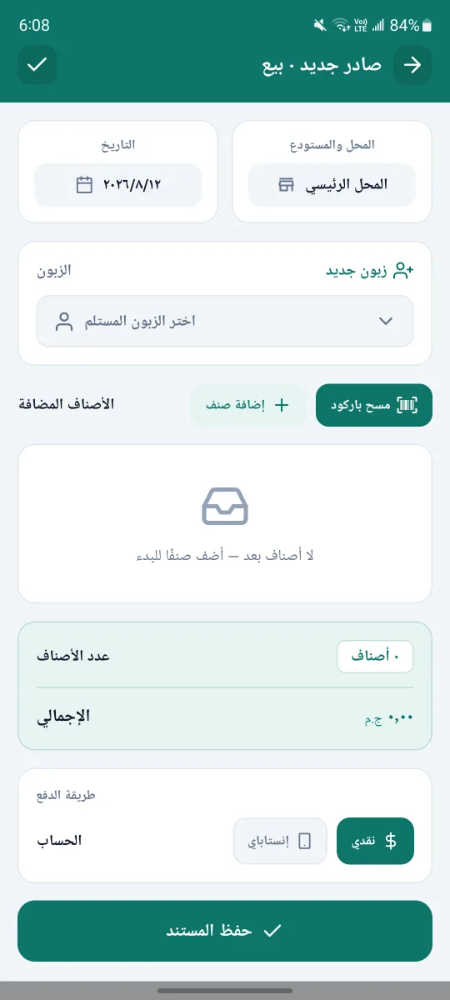
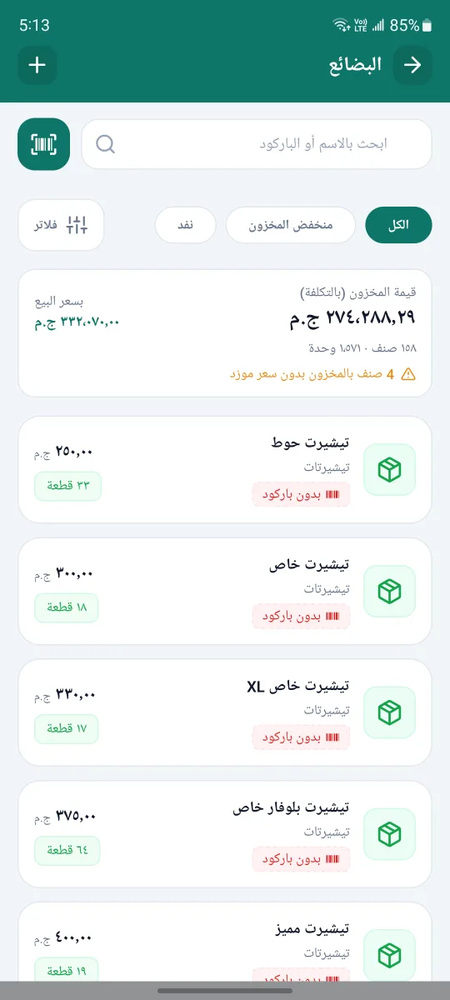
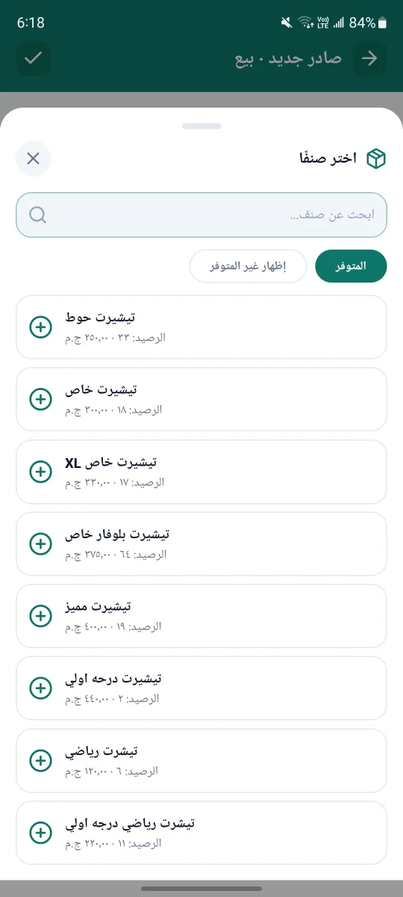
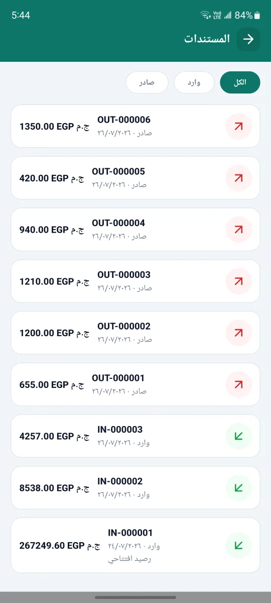
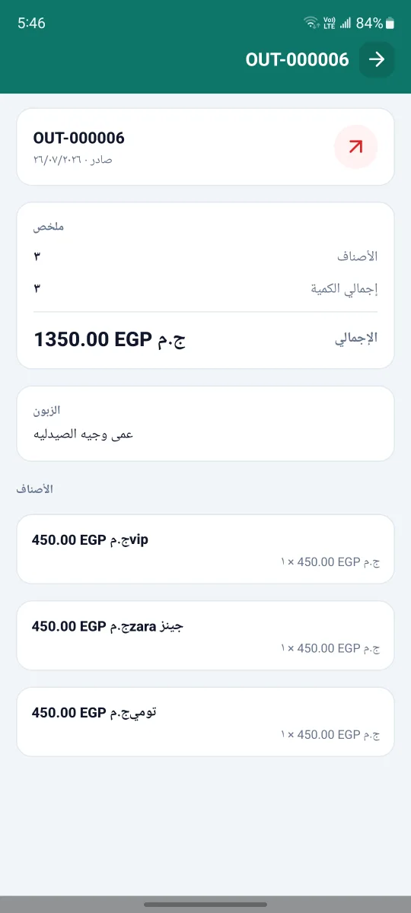
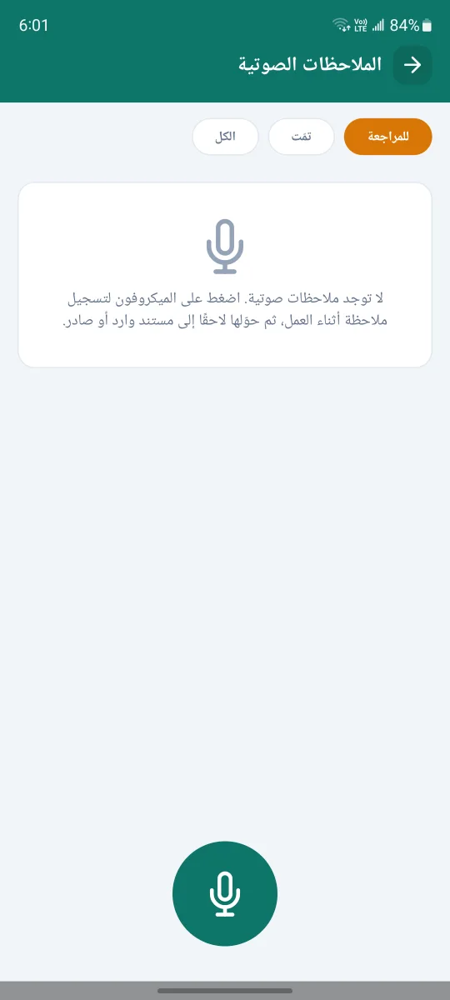

# Rafuf (رفوف)


Arabic-first, offline-first retail ERP for small shops. Stock, debts, expenses, and
profit on one phone, with no internet connection required.

Built with Expo + React Native + TypeScript. Shipped as an Android release build to a
real shop owner.

## Download

**[Download the APK (v1.1.0, Android)](https://github.com/khali70/erp_mobile/releases/download/v1.1.0/rafuf-v1.1.0-arm64-v8a.apk)**
&nbsp;&nbsp;·&nbsp;&nbsp;
[All releases](https://github.com/khali70/erp_mobile/releases)

- Android only. No iOS build has been produced yet.
- This build targets `arm64-v8a` (most phones from ~2018 onward). It will not install
  on older 32-bit `armeabi-v7a` devices.
- Sideloading requires enabling "Install unknown apps" for your browser or file manager.
- The app is fully offline. No account, no server, no network permission needed to use it.

## Screenshots

| Home | New sale | Products | Pick an item |
| --- | --- | --- | --- |
|  |  |  |  |

| Documents | Sale document | Reports | Voice notes |
| --- | --- | --- | --- |
|  |  |  |  |

## Why it exists

A shop owner needed to know three things: what is on the shelf, who owes him money, and
whether he made a profit this month. Every tool he tried assumed a stable connection, a
Latin keyboard, and a bookkeeper. Rafuf assumes none of those.

Design constraints that drove the architecture:

- **Offline is the normal case, not the fallback.** All data lives in a local SQLite
  database. There is no sync layer to be out of date.
- **Arabic first.** Full RTL layout, Arabic UI, Arabic numerals where the user expects them.
- **The books must never lie.** Stock movements are an append-only ledger, not a mutable
  quantity field, so any balance can be recomputed and audited from history.

## Features

Eleven feature modules under `src/features/`:

| Module | What it does |
| --- | --- |
| `inventory` | Items list, item movement history, stock levels, home dashboard |
| `documents` | Incoming and outgoing documents (purchases and sales) and their detail view |
| `parties` | Customers and suppliers |
| `payments` | Settling debts against documents |
| `cashbook` | Cash in and out, day by day |
| `expenses` | Operating costs |
| `reports` | Profit and loss, debts by customer, debts by supplier |
| `scan` | Barcode scanning |
| `voice-notes` | Voice capture for users who would rather speak than type |
| `settings` | Privacy mode, backup and restore, negative-stock policy |
| `updates` | In-app OTA update checks |

## Architecture

```
src/
  db/            drizzle schema, migrations, database client
  repositories/  data access, one repository per aggregate, factory-created
  features/      screen + hooks + components per module
  navigation/    native-stack navigators, typed route params
  i18n/          i18next setup and locales
  utils/         money, dates, formatting
```

**Decisions worth calling out:**

- **Money is stored as integer minor units.** No floating point anywhere in the ledger.
  Formatting to a decimal string happens only at the view layer.
- **Stock is an immutable movement log.** A sale does not decrement a number; it appends
  a movement. Current quantity is derived. Weighted-average cost of goods sold is computed
  from the same log, so profit reporting cannot drift from stock reality.
- **Repositories are created by factories over a `DocDb` interface**, so the whole data
  layer can be pointed at a real in-memory SQLite database in tests without mocking.
- **No server-cache library.** Local SQLite reads are effectively synchronous, so a query
  cache buys nothing here. State is Zustand plus plain hooks.
- **Privacy mode is a rendering rule, not a data rule.** The shopkeeper serves customers
  with the phone in view, so money aggregates can be masked on screen and auto re-mask
  after 30 seconds idle. The real values never leave memory and the data layer is untouched.

## Testing

**515 tests across 38 suites.** Run with:

```bash
bun run test
```

Jest is configured as two projects, because the two halves of the codebase need different
transforms:

- **`node`** (`ts-jest`, node environment) for the database, repositories, ledger maths,
  and utilities. These run against a **real `better-sqlite3` database**, not mocks, so the
  tests exercise actual SQL, actual migrations, and actual constraint behaviour.
- **`hooks`** (`jest-expo` preset, `@testing-library/react-native`) for hooks and
  components that need the React Native runtime.

The codebase is ~33,000 lines of TypeScript in `strict` mode with zero `: any`
annotations in `src/`.

## Tech stack

- **Runtime:** Expo SDK 57, React Native 0.86, Hermes
- **Language:** TypeScript, `strict: true`
- **Database:** expo-sqlite + drizzle-orm, versioned migrations
- **State:** zustand, react-native-mmkv for key-value settings
- **Styling:** nativewind (Tailwind for React Native)
- **Navigation:** @react-navigation/native-stack, typed route params
- **i18n:** i18next, RTL
- **Native features:** expo-camera (barcode scanning), expo-updates (OTA delivery)
- **Testing:** Jest, ts-jest, jest-expo, @testing-library/react-native, better-sqlite3

## Quick start

```bash
bun install
bunx expo run:android    # build & install the dev client
bunx expo start --dev-client
```

The app needs a dev client rather than Expo Go, because it uses native modules
(SQLite, MMKV, camera, biometrics).

## Documentation

- **[Development Guide](./dev.md)** - building the dev client, running the dev server,
  native modules, and when to rebuild vs reload.
- **[Project Overview](./docs/PROJECT.md)** - domain model and module breakdown.

## Status

Version 1.1.0, in use by the shop it was built for. Android release only.
