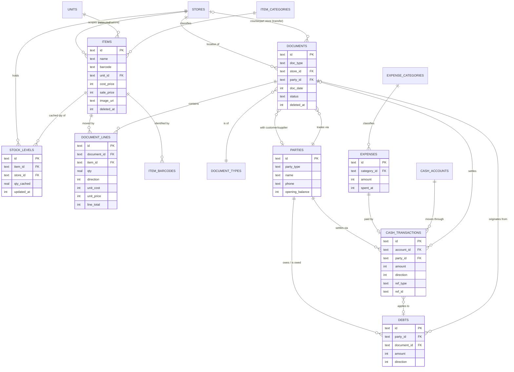

# Data Model — Offline-First Local Database

Persistent data model for the ERP mobile app (Arabic RTL, `com.stockmanagment.next.app`-style). **Product identity: local, single-user, full ERP** (stock + parties/debts + cash book + P&L) — no cloud, no accounts, no multi-device sync ([`roadmap.md`](./roadmap.md#product-identity-locked)). Designed so **Step 1** (items + incoming ledger + outgoing ledger + computed stock) is a clean, self-contained subset that later phases **extend by adding tables/columns**, never by rewriting.

This document conforms to `AGENTS.md`: **the database is touched only through the services layer.** No screen, hook, store, or component issues SQL. All persistence lives behind a repository/service API (see [§9 Service-layer boundary](#9-service-layer-boundary)) so the storage engine — and later a real backend — is swappable in one place.

---

## 1. Storage choice

### Recommendation: **Drizzle ORM on top of `expo-sqlite`**

| Candidate | Verdict |
|---|---|
| `expo-sqlite` (raw) | Foundation. First-party Expo module, New Architecture + JSI, synchronous & async APIs, WAL mode, ships with Expo Go / dev client. But raw SQL strings = no type safety, hand-rolled migrations. |
| `op-sqlite` | Fastest engine (JSI, native). Great, but a custom native module (ADR + dev-client cost per `AGENTS.md` §Bundle policy) and we do not need its raw throughput for an inventory ledger. Keep as a future drop-in — Drizzle can target it later. |
| **WatermelonDB** | Purpose-built for offline sync with a lazy/observable layer. But it imposes its **own schema/model DSL and sync protocol**, is heavier, and fights our "services layer is the only DB touch point" rule (its observables leak into the view layer). Overkill for Step 1. |
| **Drizzle ORM + `expo-sqlite`** ✅ | Type-safe schema in TS, `drizzle-kit` generates **numbered SQL migrations** (forward-only), thin runtime, no native module beyond `expo-sqlite`, and it compiles to plain SQL so we keep full control. Query builder is easily hidden behind the services layer. |

**Why this wins for offline-first RN + future sync**

- **First-party base**: `expo-sqlite` is an Expo SDK module — satisfies `AGENTS.md` "prefer Expo SDK module over community module." No ADR-triggering native module.
- **Type-safe, migration-first**: `drizzle-kit generate` diffs the TS schema and emits versioned `NNNN_name.sql` files. Forward-only, committed to git, run in order at boot. Matches [§7 Migration strategy](#7-migration-strategy).
- **Swappable**: Drizzle's dialect can be repointed from `expo-sqlite` → `op-sqlite` with a driver change only, and the whole thing sits behind `src/services/db/`. Fits the "replaceable storage" principle exactly.

### Standard columns — present on EVERY table from Step 1

This is a **local single-user** app: there is no server, so there is no sync engine, no outbox, no conflict resolution ([non-goals](./roadmap.md#explicitly-out-of-scope-non-goals)). Every row still carries these four columns because each earns its place *locally* — stable client ids, audit timestamps, and soft-delete (needed for "archive never delete" + reliable backup/restore):

| Column | Type | Purpose |
|---|---|---|
| `id` | `TEXT` PK | **UUIDv7** (time-ordered, sortable) or **ULID**. Client-generated. Sortable ids give cheap chronological ordering and keep backup/restore stable. **Never autoincrement integers.** |
| `created_at` | `INTEGER` | Unix epoch **milliseconds** (UTC). Integer, not ISO string — cheap to sort/compare. |
| `updated_at` | `INTEGER` | Unix epoch ms, bumped on every write. Drives "recently changed" ordering and incremental backup. |
| `deleted_at` | `INTEGER NULL` | **Soft-delete** tombstone. `NULL` = live. Enforces archive-never-delete and keeps referential history (a deleted item still explains old ledger rows). |

> Convention: application reads always filter `WHERE deleted_at IS NULL`, enforced centrally in the repository layer, not sprinkled through callers.

> **Optional sync-forward columns (NOT built).** If the product identity ever changed to multi-device, two more columns (`server_id TEXT NULL`, `sync_status TEXT DEFAULT 'pending'`) plus a `sync_state` table would make sync **additive, never destructive** — because the ledger is append-only (see [§5](#5-ledger--stock-design)). These are **not part of the current schema**; they are documented in [§7 sync-forward path](#optional-sync-forward-path-not-in-scope) only as a non-breaking escape hatch. Do not add them, the `sync/` folder, or a sync engine to the local build.

---

## 2. Full ER model (all observed entities)



---

## 3. Entity catalogue (per-table, phased)

Legend — **Phase**: `S1` = Step 1 subset · `S2` parties & debts · `S3` multi-store · `S4` expenses/cashbook · `S5` reports (mostly views, no new base tables) · `S8` settings/backup. (No sync phase — [non-goal](./roadmap.md#explicitly-out-of-scope-non-goals).)

Every table also carries the four standard columns from [§1](#1-storage-choice) (`id, created_at, updated_at, deleted_at`) — omitted below for brevity.

### Step 1 subset (marked ✅) — the clean minimal core

| Entity | Phase | Purpose | Key fields (`name:type`) | FKs | Indexes |
|---|---|---|---|---|---|
| **`units`** | ✅ S1 | Units of measure (piece, kg, box…). RTL Arabic labels. | `name:text`, `short_name:text`, `is_fractional:int(bool)` | — | `uq(name)` |
| **`items`** | ✅ S1 | Goods master: barcode, unit, cost & sale price, image. | `name:text`, `sku:text`, `barcode:text`, `unit_id:text`, `cost_price:int`(minor), `sale_price:int`(minor), `currency:text`, `image_uri:text`, `is_active:int` | `unit_id→units.id` | `idx(barcode)`, `idx(name)`, `uq(sku) where deleted_at is null` |
| **`documents`** | ✅ S1 | Header for any stock movement. In S1 only `incoming` & `outgoing` used. | `doc_type:text`, `doc_no:text`, `doc_date:int`, `store_id:text`(nullable in S1), `party_id:text`(null S1), `status:text`(`draft\|posted`), `note:text`, `total_amount:int` | `store_id→stores.id`, `party_id→parties.id` (both nullable) | `idx(doc_type,doc_date)`, `idx(status)` |
| **`document_lines`** | ✅ S1 | The **ledger**. One row per item movement. `direction` gives the sign. | `document_id:text`, `item_id:text`, `qty:real`, `direction:int`(`+1`/`-1`), `unit_cost:int`(minor), `unit_price:int`(minor), `line_total:int`(minor) | `document_id→documents.id`, `item_id→items.id` | `idx(item_id)`, `idx(document_id)`, `idx(item_id,created_at)` |
| **`stock_levels`** *(optional cache)* | ✅ S1 | Materialized current stock per item (per store from S3). See [§5](#5-ledger--stock-design). | `item_id:text`, `store_id:text`(null S1), `qty_cached:real`, `avg_cost:int` | `item_id→items.id`, `store_id→stores.id` | `uq(item_id,store_id)` |

> **Step 1 ships with exactly these 5 tables** (plus optionally `item_categories` if we want grouping early). Everything below is additive.

### Later-phase tables

| Entity | Phase | Purpose | Key fields | FKs | Indexes |
|---|---|---|---|---|---|
| **`item_categories`** | S1/S2 | Group items (tree via `parent_id`). | `name:text`, `parent_id:text` | `parent_id→item_categories.id` | `idx(parent_id)` |
| **`item_barcodes`** | S2 | Multiple barcodes / pack sizes per item. | `item_id:text`, `barcode:text`, `pack_qty:real` | `item_id→items.id` | `uq(barcode)` |
| **`stores`** | S3 | Warehouses / stores. S1 assumes a single implicit store. | `name:text`, `address:text`, `is_default:int` | — | `uq(name)` |
| **`parties`** | S2 | Unified customers **and** suppliers. | `party_type:text`(`customer\|supplier\|both`), `name:text`, `phone:text`, `email:text`, `address:text`, `opening_balance:int`, `currency:text` | — | `idx(party_type)`, `idx(name)`, `idx(phone)` |
| **`debts`** | S2 | Running receivable/payable per party, per originating doc. | `party_id:text`, `document_id:text`, `amount:int`(minor), `direction:int`(`+1` owed to us / `-1` we owe), `due_date:int`, `settled_amount:int` | `party_id→parties.id`, `document_id→documents.id` | `idx(party_id)`, `idx(document_id)` |
| **`cash_accounts`** | S4 | Cash boxes / bank accounts (cash book). | `name:text`, `kind:text`(`cash\|bank`), `opening_balance:int`, `currency:text` | — | `uq(name)` |
| **`cash_transactions`** | S4 | Every money movement (cash book lines). | `account_id:text`, `party_id:text`, `amount:int`(minor), `direction:int`(`+1` in / `-1` out), `method:text`, `ref_type:text`(`document\|debt\|expense\|manual`), `ref_id:text`, `txn_date:int` | `account_id→cash_accounts.id`, `party_id→parties.id` | `idx(account_id,txn_date)`, `idx(ref_type,ref_id)`, `idx(party_id)` |
| **`expense_categories`** | S4 | Classify expenses (rent, salaries…). | `name:text`, `parent_id:text` | `parent_id→expense_categories.id` | `idx(parent_id)` |
| **`expenses`** | S4 | Business expenses. | `category_id:text`, `amount:int`(minor), `currency:text`, `spent_at:int`, `note:text`, `cash_txn_id:text` | `category_id→expense_categories.id`, `cash_txn_id→cash_transactions.id` | `idx(category_id)`, `idx(spent_at)` |
| **`document_types`** *(optional lookup)* | S2 | Reference table if `doc_type` graduates from a string enum to FK. Keeps S1 as a plain `TEXT` enum to avoid a join. | `code:text`, `label:text`, `sign_convention:text` | — | `uq(code)` |
| **`app_settings`** | S8 | Single-row (or key-value) app config: default currency, number/date format, default store, theme, `allow_negative_stock`, valuation method. | `key:text`, `value:text` | — | `uq(key)` |

> `sync_state` and per-row sync columns are **not** in this schema — local single-user product. See [§7 sync-forward path](#optional-sync-forward-path-not-in-scope).

**Document types** (`documents.doc_type` enum values across the whole app):

| `doc_type` | Line direction convention | Money side | Phase |
|---|---|---|---|
| `incoming` | lines `+1` (stock in) | purchase → supplier payable | ✅ S1 (stock only) / S2 (money) |
| `outgoing` | lines `-1` (stock out) | sale → customer receivable | ✅ S1 (stock only) / S2 (money) |
| `transfer` | two legs: `-1` from source store, `+1` into `counterpart_store_id` | no money | S3 |
| `inventory` (count/adjust) | line `direction` = sign of `(counted − expected)` | no money | S3 |

---

## 4. SQL DDL

### 4.1 Step-1 subset — full DDL (SQLite dialect)

```sql
PRAGMA journal_mode = WAL;
PRAGMA foreign_keys = ON;

-- ── units ────────────────────────────────────────────────────────────────
CREATE TABLE units (
  id           TEXT PRIMARY KEY,                       -- UUIDv7 / ULID
  name         TEXT NOT NULL,                          -- e.g. "قطعة", "كيلو"
  short_name   TEXT,
  is_fractional INTEGER NOT NULL DEFAULT 0,            -- 0/1: allow decimal qty
  -- standard columns
  created_at   INTEGER NOT NULL,
  updated_at   INTEGER NOT NULL,
  deleted_at   INTEGER
);
CREATE UNIQUE INDEX uq_units_name ON units(name) WHERE deleted_at IS NULL;

-- ── items ────────────────────────────────────────────────────────────────
CREATE TABLE items (
  id           TEXT PRIMARY KEY,
  name         TEXT NOT NULL,
  sku          TEXT,
  barcode      TEXT,
  unit_id      TEXT REFERENCES units(id),
  cost_price   INTEGER NOT NULL DEFAULT 0,             -- minor units (see §6)
  sale_price   INTEGER NOT NULL DEFAULT 0,             -- minor units
  currency     TEXT NOT NULL DEFAULT 'EGP',            -- ISO 4217
  image_uri    TEXT,                                   -- local file:// or remote
  is_active    INTEGER NOT NULL DEFAULT 1,
  -- standard columns
  created_at   INTEGER NOT NULL,
  updated_at   INTEGER NOT NULL,
  deleted_at   INTEGER
);
CREATE INDEX        idx_items_barcode ON items(barcode);
CREATE INDEX        idx_items_name    ON items(name);
CREATE UNIQUE INDEX uq_items_sku      ON items(sku) WHERE sku IS NOT NULL AND deleted_at IS NULL;

-- ── documents (headers) ──────────────────────────────────────────────────
CREATE TABLE documents (
  id            TEXT PRIMARY KEY,
  doc_type      TEXT NOT NULL,                         -- 'incoming' | 'outgoing' (S1)
  doc_no        TEXT,                                  -- human-facing sequence
  doc_date      INTEGER NOT NULL,                      -- epoch ms
  store_id      TEXT,                                  -- nullable in S1 (single store)
  party_id      TEXT,                                  -- nullable in S1 (no parties yet)
  status        TEXT NOT NULL DEFAULT 'posted',        -- 'draft' | 'posted'
  note          TEXT,
  total_amount  INTEGER NOT NULL DEFAULT 0,            -- minor units, cached sum of lines
  currency      TEXT NOT NULL DEFAULT 'EGP',
  -- standard columns
  created_at    INTEGER NOT NULL,
  updated_at    INTEGER NOT NULL,
  deleted_at    INTEGER,
  CHECK (doc_type IN ('incoming','outgoing','transfer','inventory'))
);
CREATE INDEX idx_documents_type_date ON documents(doc_type, doc_date);
CREATE INDEX idx_documents_status    ON documents(status);

-- ── document_lines (THE LEDGER) ──────────────────────────────────────────
CREATE TABLE document_lines (
  id            TEXT PRIMARY KEY,
  document_id   TEXT NOT NULL REFERENCES documents(id) ON DELETE CASCADE,
  item_id       TEXT NOT NULL REFERENCES items(id),
  qty           REAL NOT NULL,                         -- always positive magnitude
  direction     INTEGER NOT NULL,                      -- +1 in, -1 out
  unit_cost     INTEGER NOT NULL DEFAULT 0,            -- minor units
  unit_price    INTEGER NOT NULL DEFAULT 0,            -- minor units
  line_total    INTEGER NOT NULL DEFAULT 0,            -- minor units
  -- standard columns
  created_at    INTEGER NOT NULL,
  updated_at    INTEGER NOT NULL,
  deleted_at    INTEGER,
  CHECK (direction IN (-1, 1)),
  CHECK (qty >= 0)
);
CREATE INDEX idx_lines_item        ON document_lines(item_id);
CREATE INDEX idx_lines_document    ON document_lines(document_id);
CREATE INDEX idx_lines_item_created ON document_lines(item_id, created_at);

-- ── stock_levels (materialized cache — see §5) ───────────────────────────
CREATE TABLE stock_levels (
  id           TEXT PRIMARY KEY,
  item_id      TEXT NOT NULL REFERENCES items(id),
  store_id     TEXT,                                   -- NULL sentinel = single store (S1)
  qty_cached   REAL NOT NULL DEFAULT 0,
  avg_cost     INTEGER NOT NULL DEFAULT 0,             -- moving-average cost, minor units
  -- standard columns (derived cache; rebuildable from the ledger at any time)
  created_at   INTEGER NOT NULL,
  updated_at   INTEGER NOT NULL,
  deleted_at   INTEGER
);
CREATE UNIQUE INDEX uq_stock_item_store
  ON stock_levels(item_id, IFNULL(store_id, ''));
```

### 4.2 Later-phase DDL — sketch (abbreviated)

```sql
-- S2 ── parties (customers + suppliers unified) ---------------------------
CREATE TABLE parties (
  id TEXT PRIMARY KEY, party_type TEXT NOT NULL,        -- 'customer'|'supplier'|'both'
  name TEXT NOT NULL, phone TEXT, email TEXT, address TEXT,
  opening_balance INTEGER NOT NULL DEFAULT 0, currency TEXT NOT NULL DEFAULT 'EGP',
  /* + std cols */  CHECK (party_type IN ('customer','supplier','both'))
);
CREATE INDEX idx_parties_type ON parties(party_type);

-- S2 ── debts (per party, per originating document) -----------------------
CREATE TABLE debts (
  id TEXT PRIMARY KEY, party_id TEXT NOT NULL REFERENCES parties(id),
  document_id TEXT REFERENCES documents(id),
  amount INTEGER NOT NULL, direction INTEGER NOT NULL,  -- +1 receivable / -1 payable
  settled_amount INTEGER NOT NULL DEFAULT 0, due_date INTEGER
  /* + std cols */
);
CREATE INDEX idx_debts_party ON debts(party_id);

-- S2 ── item extras --------------------------------------------------------
CREATE TABLE item_categories (id TEXT PRIMARY KEY, name TEXT NOT NULL, parent_id TEXT /* +std cols */);
CREATE TABLE item_barcodes  (id TEXT PRIMARY KEY, item_id TEXT NOT NULL REFERENCES items(id),
                             barcode TEXT NOT NULL, pack_qty REAL NOT NULL DEFAULT 1 /* +std cols */);

-- S3 ── stores (multi-store) ----------------------------------------------
CREATE TABLE stores (id TEXT PRIMARY KEY, name TEXT NOT NULL, address TEXT,
                     is_default INTEGER NOT NULL DEFAULT 0 /* +std cols */);
-- transfers reuse `documents` with doc_type='transfer' + counterpart_store_id column
ALTER TABLE documents ADD COLUMN counterpart_store_id TEXT REFERENCES stores(id);

-- S4 ── cash book + expenses ----------------------------------------------
CREATE TABLE cash_accounts (id TEXT PRIMARY KEY, name TEXT NOT NULL, kind TEXT NOT NULL,
                            opening_balance INTEGER NOT NULL DEFAULT 0, currency TEXT /* +std cols */);
CREATE TABLE cash_transactions (
  id TEXT PRIMARY KEY, account_id TEXT NOT NULL REFERENCES cash_accounts(id),
  party_id TEXT REFERENCES parties(id), amount INTEGER NOT NULL,
  direction INTEGER NOT NULL,                           -- +1 in / -1 out
  method TEXT, ref_type TEXT, ref_id TEXT, txn_date INTEGER NOT NULL /* +std cols */
);
CREATE INDEX idx_cashtxn_ref ON cash_transactions(ref_type, ref_id);
CREATE TABLE expense_categories (id TEXT PRIMARY KEY, name TEXT NOT NULL, parent_id TEXT /* +std cols */);
CREATE TABLE expenses (
  id TEXT PRIMARY KEY, category_id TEXT REFERENCES expense_categories(id),
  amount INTEGER NOT NULL, currency TEXT, spent_at INTEGER NOT NULL,
  note TEXT, cash_txn_id TEXT REFERENCES cash_transactions(id) /* +std cols */
);

-- S8 ── app settings (key-value config) -----------------------------------
CREATE TABLE app_settings (id TEXT PRIMARY KEY, key TEXT NOT NULL, value TEXT /* +std cols */);
CREATE UNIQUE INDEX uq_settings_key ON app_settings(key);
```

> No `sync_state` / sync columns — local single-user product. See [§7 sync-forward path](#optional-sync-forward-path-not-in-scope).

### 4.3 Reports (S5) — no new base tables, use views

Reporting aggregates (P&L, sales by item/date/customer/month, purchases by item/supplier, stock movement) are **derived**, so they are SQL `VIEW`s / parameterized queries over the ledger, not stored tables. Example:

```sql
-- current stock per item (recompute-on-read form)
CREATE VIEW v_stock_on_hand AS
SELECT l.item_id, IFNULL(d.store_id,'') AS store_id,
       SUM(l.qty * l.direction) AS qty_on_hand
FROM document_lines l
JOIN documents d ON d.id = l.document_id
WHERE l.deleted_at IS NULL AND d.deleted_at IS NULL AND d.status = 'posted'
GROUP BY l.item_id, IFNULL(d.store_id,'');

-- sales by item (outgoing), a P&L building block
CREATE VIEW v_sales_by_item AS
SELECT l.item_id,
       SUM(l.qty)                          AS qty_sold,
       SUM(l.line_total)                   AS revenue,       -- minor units
       SUM(l.qty * l.unit_cost)            AS cogs,          -- minor units
       SUM(l.line_total - l.qty*l.unit_cost) AS gross_profit
FROM document_lines l JOIN documents d ON d.id = l.document_id
WHERE d.doc_type = 'outgoing' AND l.direction = -1
  AND l.deleted_at IS NULL AND d.deleted_at IS NULL AND d.status='posted'
GROUP BY l.item_id;
```

---

## 5. Ledger & stock design

### The double-sided document model

Stock is **never edited directly**. It is the running total of an append-only ledger:

- Every physical movement is a `document` (header) with one or more `document_lines`.
- Each line stores a **positive `qty`** plus a **`direction`** (`+1` = into stock, `−1` = out of stock).
  - `incoming` document → lines `direction = +1`.
  - `outgoing` document → lines `direction = −1`.
  - (later) `transfer` → two legs, `−1` from source, `+1` into destination.
  - (later) `inventory` count → an adjustment line signed by `counted − expected`.
- **Current stock of an item = `SUM(qty * direction)`** over all its non-deleted, posted lines.

This gives a full, auditable, reversible history for free: correcting a mistake is a new counter-line, not an in-place mutation — which is exactly what makes the ledger **sync-safe** (append-only rows merge cleanly; a mutated running balance would not).

### Computed aggregate vs cached column — the trade-off

| Approach | How | Pros | Cons |
|---|---|---|---|
| **Recompute-on-read** | `SELECT SUM(qty*direction) … GROUP BY item_id` (view `v_stock_on_hand`) | Zero denormalization, impossible to drift, trivially correct, no triggers. | Cost grows with ledger size; an item list showing stock for 1000 items does 1000 aggregations (mitigated by `idx_lines_item`). |
| **Materialized cache** (`stock_levels.qty_cached`) | On each line insert/update/delete, apply the delta to `stock_levels`. | O(1) reads — instant item lists & low-stock alerts. Also the natural home for **moving-average `avg_cost`** (needed for COGS/P&L). | Must be kept in lockstep with the ledger or it drifts; needs triggers or a single write path; a rebuild routine for safety. |

### Recommendation

**Step 1: recompute-on-read via `v_stock_on_hand`, and ALSO create the `stock_levels` table now but populate it through the repository write path (no triggers yet).**

Rationale:
- Step 1 catalogs are small; the view is correct-by-construction and removes a whole class of "cache drift" bugs while the schema is still moving.
- Creating the empty `stock_levels` table in the first migration means **no schema change later** — we only flip the read source.
- Because **all writes go through the services layer** (`AGENTS.md`), we update `stock_levels` in the *same transaction* that inserts the lines — application-level maintenance, no SQLite triggers. Easier to unit-test with a mocked db and keeps logic in TS where it is reviewable.

**Migration path to the cache (when item counts / list perf demand it):**
1. Switch read APIs from `v_stock_on_hand` → `stock_levels.qty_cached` (services layer only; screens unchanged).
2. Ship a one-time **rebuild** function: `qty_cached = SUM(qty*direction)` per `(item_id, store_id)` — idempotent, safe to re-run after any suspected drift.
3. Optionally add SQLite `AFTER INSERT/UPDATE/DELETE` triggers on `document_lines` as a belt-and-suspenders backstop once the write path is proven.
4. `avg_cost` (moving average) is maintained on each `+1` line: `new_avg = (old_qty*old_avg + in_qty*unit_cost) / (old_qty+in_qty)`; consumed by outgoing lines as COGS for P&L.

The view stays defined forever as the **source of truth for reconciliation** — the rebuild job simply copies it into the cache.

---

## 6. Money handling

- **Store every monetary value as an integer in minor units** (piastres/cents): `cost_price`, `sale_price`, `line_total`, `total_amount`, `amount`, `opening_balance`, `avg_cost`, etc. Never `REAL`/float for money — binary floating point cannot represent `0.10` exactly and rounding errors accumulate across a ledger.
  - Example: `12.50 EGP` → stored as `1250`.
- **`currency` column** (`TEXT`, ISO 4217, default `'EGP'`) travels with every money-bearing row (items, documents, parties, cash accounts, expenses). Enables multi-currency later without migration; Step 1 keeps a single app-wide default from settings.
- **Minor-unit exponent** is per-currency (EGP/USD = 2, some currencies 0 or 3). Keep a small lookup in `src/utils/money.ts` (`currencyExponent(code)`); do **not** hardcode `/100` at call sites.
- **Rounding rules**:
  - Convert to minor units at the input boundary (parse UI decimal → integer) using **round-half-up (banker's optional)** to the currency exponent. One rounding, at the edge.
  - All arithmetic (line totals, sums, averages) is integer math on minor units — associative and exact.
  - `line_total = round(qty * unit_price)` — `qty` may be fractional (e.g. 1.5 kg), so this single multiplication is the only place a fractional→integer rounding occurs; round half-up.
  - Moving-average `avg_cost` division rounds half-up to the minor unit; the residual is absorbed on the next movement (never surfaced to the user as a phantom sub-cent).
  - Display formatting (grouping, RTL digit shaping, currency symbol) uses `Intl.NumberFormat` with the locale from `expo-localization` — formatting only, never for storage.
- **Helpers** live in `src/utils/money.ts` (pure, no IO): `toMinor(decimalStr, currency)`, `fromMinor(int, currency)`, `formatMoney(int, currency, locale)`. Repositories accept/return integers; only the view layer formats.

---

## 7. Migration strategy

### Numbered, forward-only

- Migrations are **numbered SQL files**, `drizzle-kit`-generated from the TS schema: `drizzle/0000_init.sql`, `0001_add_parties.sql`, … committed to git.
- A `schema_migrations(version INTEGER PRIMARY KEY, applied_at INTEGER)` table records what has run.
- On app boot, `src/services/db/migrate.ts` runs every migration whose `version` exceeds the max applied, **in order, inside a transaction**. Idempotent and offline — no network.
- **Forward-only. No `down`/rollback.** A bad migration is fixed by a new higher-numbered migration. (Mobile devices can be on any historical version; only forward paths are reachable in the field.)

### Phase progression is purely additive

| From → To | Change kind | Safety |
|---|---|---|
| **S1 → S2** (parties, money on docs, debts) | `CREATE TABLE parties/debts/…`; `documents.party_id` already exists (nullable). Money columns already present. | New tables + already-nullable columns → **no rewrite of existing rows**. |
| **S2 → S3** (multi-store) | `CREATE TABLE stores`; `ALTER TABLE documents ADD COLUMN counterpart_store_id`; backfill `store_id` on existing docs/stock to the default store id. | `ADD COLUMN` is O(1) in SQLite; nullable/defaulted → non-destructive. Backfill is a data-only `UPDATE`. |
| **S3 → S4** (cash, expenses) | New tables only. | Fully additive. |
| **S4 → S5** (reports) | `CREATE VIEW …` only. | No base-table change. |
| **S5 → S8** (settings, backup) | `CREATE TABLE app_settings`. Backup/restore is code (serialize/deserialize the DB), no schema change. | Fully additive. |

**Golden rules that keep migrations non-breaking:** new columns are always `NULL`able or `DEFAULT`ed; never rename/drop a shipped column (add a new one + backfill + stop reading the old); never change a column's type in place; enums that may grow (`doc_type`, `party_type`) are `TEXT` + `CHECK`, and widening a `CHECK` is a table-rebuild migration done rarely and deliberately.

### Optional sync-forward path (NOT in scope)

The current product is **local single-user** — there is no backend, no sync engine, no `sync/` folder. This subsection exists only to record that the schema does not *foreclose* sync, should the product identity ever change. Nothing here is built.

- The append-only ledger is the enabling property: **`document_lines` are conflict-free** — two devices adding movements simply union, and stock re-derives correctly from the merged ledger. Only scalar master rows (items, parties) would need last-write-wins on `updated_at`.
- Turning it on would be **additive**: add `server_id TEXT NULL` + `sync_status TEXT DEFAULT 'pending'` per table (nullable/defaulted → non-destructive), add a `sync_state` cursor table, and add `src/services/sync/` behind the existing repositories. FKs reference local `id` (permanent), so nothing rewires.
- Until then: do not add these columns, the table, or the folder. They are dead weight in a single-device app.

---

## 8. Naming conventions

- **Tables**: `snake_case`, **plural** (`items`, `document_lines`, `cash_transactions`).
- **Columns**: `snake_case`. Foreign keys `<singular>_id` (`item_id`, `document_id`).
- **Timestamps**: `created_at`, `updated_at`, `deleted_at` — all `INTEGER` Unix epoch **milliseconds, UTC**. Domain dates that are conceptually a day (`doc_date`, `spent_at`, `txn_date`, `due_date`) are also epoch-ms integers.
- **Soft delete**: `deleted_at INTEGER NULL`; live rows have `NULL`. Reads filter `deleted_at IS NULL` in the repository layer.
- **Booleans**: `INTEGER` `0/1` with an `is_` prefix (`is_active`, `is_default`, `is_fractional`).
- **Money**: `INTEGER` minor units; a paired `currency TEXT` where the value can be multi-currency.
- **Enums**: `TEXT` + `CHECK(col IN (...))`. Values are lowercase snake (`incoming`, `party_type`).
- **Indexes**: `idx_<table>_<cols>`; unique `uq_<table>_<cols>`.
- **Primary keys**: `id TEXT` (UUIDv7/ULID), client-generated.
- **Standard columns** (`id`, `created_at`, `updated_at`, `deleted_at`) present on every table.

---

## 9. Service-layer boundary

Per `AGENTS.md` (the DB is the local source of truth; only `src/services/` touches it):

```
src/services/db/
  client.ts        # opens expo-sqlite, applies PRAGMAs (WAL, foreign_keys). ONLY place that imports expo-sqlite.
  schema.ts        # Drizzle table definitions (source of truth → drizzle-kit migrations)
  migrate.ts       # runs numbered migrations on boot
  backup.ts        # (S8) serialize/restore whole DB to a shareable file; no network
  repositories/
    itemsRepo.ts        # CRUD over items (+ units)
    documentsRepo.ts    # create incoming/outgoing docs + lines in one txn; maintains stock_levels
    stockRepo.ts        # read stock (v_stock_on_hand in S1 → stock_levels cache later)
```

- Feature services (`features/inventory/services/…`) call these repositories; they never issue SQL.
- Screens → hooks (TanStack Query wrapping repo calls for cache/invalidation, **not** as the store of record) → services → db. The repository is the swap point: the engine can move `expo-sqlite` → `op-sqlite` in one place with no screen/hook changes.
- No React, no navigation, no zustand inside `services/db/` (AGENTS.md §Data layer).
- **No `sync/` folder, no `api/client`** — local single-user product ([non-goals](./roadmap.md#explicitly-out-of-scope-non-goals)).
```
