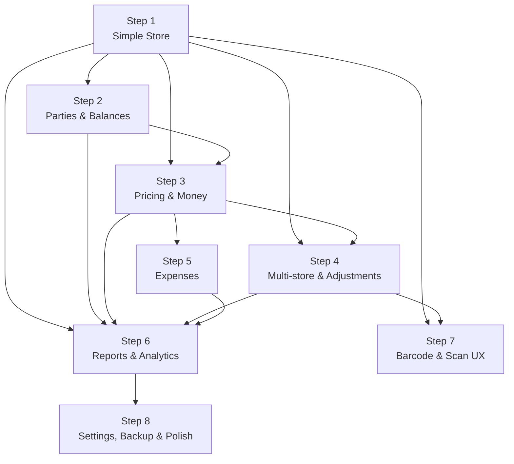

# ERP Mobile — Phased Roadmap

> Clone target: `com.stockmanagment.next.app` — an Arabic-first (RTL) "Inventory & Stock, Simply" style app.
> Architecture contract: [`AGENTS.md`](../../AGENTS.md) — RN + Expo, feature-isolated modules, offline-first, zustand + TanStack Query, one ERP module per milestone.
> Step 1 detail lives in its own doc: [`step-1-simple-store.md`](./step-1-simple-store.md). This file owns breadth + sequencing only.

## Product identity (locked)

**Local, single-user, full ERP.** One person runs the whole shop on one device. No accounts, no login, no cloud, no multi-device sync, no roles/permissions — ever (see [Explicitly out of scope](#explicitly-out-of-scope-non-goals)). The trade for dropping sync: no distributed-conflict problem, no auth surface, no server to run or pay for. Data safety comes from **local backup/restore + export**, not a cloud.

"Full ERP" is not aspirational — customers/suppliers with **debts (AR/AP)**, **cash book**, and **Profit & Loss** are *core* deliverables, on the same footing as stock. The report set (P&L, debts by customer/supplier, cash book, sales/purchases by X, stock movement) is the headline, not an add-on.

## Product vision

A fast, offline-first, Arabic-native inventory **and accounting** app for a single small-merchant owner: track goods, record incoming/outgoing/transfer/count documents, know current stock and stock movement at a glance, manage customers and suppliers with their **receivable/payable debts**, price items at cost and sale, log expenses and cash through a **cash book**, and read the business through a rich report set topped by **Profit & Loss** — scanning barcodes to move faster. Everything runs locally on one device; a full local backup keeps the data safe. Each phase ships a usable app on its own; later phases layer money, parties, multi-store, and reports onto a stable local core without rewrites.

## Phase table

| Phase | Name | Scope (features) | New entities | Depends on | Ships |
|---|---|---|---|---|---|
| **Step 1** | Simple Store | Items/goods CRUD, incoming (income) ledger, outgoing (export) ledger, current stock, stock movement — offline only. See [step-1 doc](./step-1-simple-store.md). | `Item`, `IncomingEntry`, `OutgoingEntry`, `StockMovement` (derived) | — | Single-store offline stock tracker |
| **Step 2** | Parties & Balances | Customers + suppliers CRUD, attach party to in/out docs, per-party ledger, debts-owed (receivables) & debts-owing (payables) running balances | `Customer`, `Supplier`, `PartyTransaction` | Step 1 | Who owes what, per party |
| **Step 3** | Pricing & Money | Cost vs sale price per item, line/doc discounts, doc totals, margin, cash book (cash in/out incl. party settlements) | `PriceInfo` (on Item), `Discount`, `Payment`, `CashEntry` | Step 1, 2 | Money-aware documents + cash book |
| **Step 4** | Multi-store & Adjustments | Multiple stores/warehouses, stock transfer doc between stores, inventory-count doc, count-driven adjustment | `Store`, `TransferDoc`, `InventoryCountDoc`, `StockAdjustment` | Step 1 (stock), 3 (valuation) | Multi-location stock with counts + transfers |
| **Step 5** | Expenses | Expense categories, expense entries, feed into cash book + P&L | `ExpenseCategory`, `Expense` | Step 3 (cash) | Operating-cost tracking |
| **Step 6** | Reports & Analytics | The observed report set: P&L, debts by customer, debts by supplier, purchases by item/supplier, sales by item/date/customer/month, stock movement, cash book, documents list, transactions list; filters, date ranges, export | none (read models / query views) | Steps 1–5 | Full reporting suite |
| **Step 7** | Barcode & Scan UX | Barcode field on item, camera scan to add/find item, scan-to-build document lines, quick-count via scan | `Barcode` (on Item) | Step 1, 4 | Scan-driven data entry |
| **Step 8** | Settings, Backup & Polish | Settings hub (currency, number/date format, default store, theme, `allowNegativeStock`), i18n polish (Arabic/English), **full local backup/restore (JSON) + per-entity CSV export/import**, data reset | `AppSettings`, `BackupManifest` | Steps 1–6 (backup covers all data); export works offline from Step 1 | Production-grade, backup-safe, single-user |

> **No Step 9.** Cloud sync, auth, multi-device, and RBAC roles are **out of scope** for this product (see below), not a later phase. The old "Step 8 Sync / Step 9 Roles" plan is retired.

### One-line justification per ordering choice

- **Step 2 before money** — parties are referenced by every priced document and by receivable/payable balances; introducing them first avoids reworking document schemas later.
- **Step 3 (money) before multi-store** — inventory valuation, transfer cost, and count adjustments all need cost/sale prices to be meaningful.
- **Step 4 before Step 5** — expenses are simple once cash book exists; multi-store is the harder stock-model change and should stabilize first.
- **Step 6 after 1–5** — reports are read models over already-captured data; building them earlier means rebuilding as entities change.
- **Step 7 (barcode) after multi-store** — scanning is a UX accelerator over existing item/document/count flows, not a data model of its own; highest value once counts and transfers exist.
- **Step 8 (settings/backup/polish) last** — backup/restore must cover every entity, so it rides on a feature-complete schema; i18n and format polish are cross-cutting finishing work. Backup is the single-user product's answer to data safety (no cloud), so it is a first-class deliverable, not an afterthought.

## Per-phase detail

### Step 1 — Simple Store
- Item catalog CRUD (name, unit, opening qty, optional barcode placeholder).
- Incoming ledger (add stock) and outgoing ledger (remove stock) entry forms.
- Current stock per item derived from opening + in − out.
- Stock movement timeline per item (chronological in/out with running balance).
- Empty/loading/error UX primitives wired; MMKV persistence.
- **Entities:** `Item`, `IncomingEntry`, `OutgoingEntry`, `StockMovement` (derived).
- **Done when:** a user can add items, record incoming and outgoing offline, and current stock + per-item movement are always correct after app restart. (Full spec in the sibling doc.)

### Step 2 — Parties & Balances
- Customers and suppliers CRUD with contact fields.
- Optional party link on incoming (supplier) and outgoing (customer) entries.
- Per-party transaction ledger view.
- Running receivables (customers owe us) and payables (we owe suppliers).
- Party picker component reused by document forms.
- **Entities:** `Customer`, `Supplier`, `PartyTransaction`.
- **Done when:** every in/out doc can name a party, and each party screen shows its transactions and a correct running balance.

### Step 3 — Pricing & Money
- Item cost price + sale price fields; default price applied on document lines.
- Line and document-level discounts; computed totals and gross margin.
- Payment records against documents/parties (partial + full).
- Cash book: chronological cash-in / cash-out incl. party settlements, running cash balance.
- **Entities:** `PriceInfo` (on `Item`), `Discount`, `Payment`, `CashEntry`.
- **Done when:** documents carry priced totals with discounts, payments update party balances, and the cash book reconciles to the sum of its entries.

### Step 4 — Multi-store & Adjustments
- Store/warehouse management; active-store selector affecting all stock views.
- Stock-transfer document moving qty between stores (out of A, into B, atomic).
- Inventory-count document capturing counted qty per item per store.
- Count-driven stock adjustment (expected vs counted → adjustment movement).
- Per-store current stock and movement.
- **Entities:** `Store`, `TransferDoc`, `InventoryCountDoc`, `StockAdjustment`.
- **Done when:** stock is tracked per store, transfers conserve total quantity, and a completed count writes adjustments that reconcile counted vs system stock.

### Step 5 — Expenses
- Expense category management.
- Expense entry form (category, amount, date, note, optional store/party).
- Expenses posted to the cash book as cash-out.
- Expenses feed the P&L cost side.
- **Entities:** `ExpenseCategory`, `Expense`.
- **Done when:** expenses can be categorized and recorded, appear in the cash book, and reduce P&L profit.

### Step 6 — Reports & Analytics
- Report catalog screen; shared date-range + store + party filter controls.
- Financial: Profit & Loss, Cash book, Debts by customer, Debts by supplier.
- Purchases: by item, by supplier. Sales: by item, by date, by customer, by month.
- Operational: Stock movement, Documents list, Transactions list.
- Export each report (CSV/PDF share sheet).
- **Entities:** none — read models / query views over Steps 1–5 data.
- **Done when:** every observed report renders from local data with working filters and matches hand-computed spot checks.

### Step 7 — Barcode & Scan UX
- Barcode field on items; uniqueness lookup.
- Camera scanner (expo-camera / vision-camera) to find or create an item.
- Scan-to-add-line while building incoming/outgoing/transfer documents.
- Rapid scan mode for inventory counts.
- **Entities:** `Barcode` (attribute on `Item`).
- **Done when:** scanning a code resolves to the right item (or offers create) and can drive document-line and count entry hands-free.

### Step 8 — Settings, Backup & Polish
- Settings hub: currency, number/date format, default store, theme, `allowNegativeStock`, valuation method display.
- i18n polish: complete Arabic + English catalogs, RTL edge-case fixes.
- **Full local backup/restore:** one-tap JSON snapshot of the entire SQLite DB (all entities) to a shareable file / device storage; restore replaces local state. Optional scheduled reminder. This is the product's whole data-safety story — no cloud.
- Per-entity CSV export/import (items, parties, documents) via share sheet / file picker.
- Data reset (with backup-first guard).
- **Entities:** `AppSettings`, `BackupManifest`.
- **Done when:** a full backup can be exported and restored to reproduce state exactly, language/RTL switches cleanly, and settings drive currency/format/negative-stock behavior app-wide.

### Explicitly out of scope (non-goals)
- **No cloud sync / backend / OpenAPI client** — the app is a self-contained local SQLite product.
- **No auth / accounts / login / sessions** — single device, single implicit user. App-lock (PIN/biometric via `expo-local-authentication`) is the *only* gate, and it's optional (a Step-8 setting), not identity.
- **No multi-device, no change-log/outbox, no conflict resolution** — dropping these removes the single hardest design problem (concurrent stock merge) from the whole project.
- **No RBAC / roles / permissions** — one user owns everything.

> These stay out **permanently** under the current product identity. The schema keeps timestamps + soft-delete (locally useful anyway), so *if* the identity ever changed, sync could be added non-destructively — but nothing here is built or scaffolded for it.

## Dependency diagram

## Cross-cutting concerns

| Concern | Introduced | Hardened | Notes |
|---|---|---|---|
| **Local persistence** | Step 1 (SQLite + Drizzle as the single source of truth; see [`data-model.md`](./data-model.md)) | Step 6 (report query perf: indexes / cached rollups) | Local-only, no sync layer. TanStack Query is an in-memory cache over repo reads, not the store of record. |
| **RTL / i18n** | Step 1 (RTL layout, logical props, `t()` keys, Arabic source) | Step 8 (full catalogs, RTL edge cases, EN parity) | No literal strings in JSX from day one (lint-enforced). |
| **Backup / export** | Step 6 (per-report CSV/PDF export) | Step 8 (full local JSON backup/restore + per-entity CSV import) | The single-user data-safety story. Reads local data; works offline. |
| **App lock (optional)** | Step 8 setting (PIN/biometric via `expo-local-authentication` + SecureStore) | — | Device gate only, not auth/identity. Off by default. |
| **Testing** | Step 1 (Jest + RNTL for services/hooks/screens, Maestro golden path) | Step 6 (report correctness spot-checks), Step 8 (backup→restore round-trip e2e) | Critical-path coverage per AGENTS.md, not line %. |
| **Analytics / observability** | Step 1 (Sentry + ErrorBoundary, breadcrumbs) | Step 6 (report/query errors) | Local crash/error reporting only; typed event registry; PII redaction from start. |

> **Dropped concerns** (were cross-cutting under the old sync plan): RBAC, change-log/mutation queue, conflict resolution, offline-reconnect e2e. Gone with sync — see [non-goals](#explicitly-out-of-scope-non-goals).

## Risks & unknowns

- **Inventory valuation method (Step 3/4).** FIFO vs weighted-average vs last-cost changes P&L and adjustment math; pick early — retrofitting valuation is expensive. **Decision locked: weighted-average** (store `unit_cost` on every incoming line from Step 1; maintain moving `avg_cost` on `stock_levels`). Revisit only if the owner needs FIFO/lot tracking. This is now the single highest-stakes design item (P&L correctness depends on it).
- **Money precision for P&L.** A full-ERP P&L on floating-point money drifts (COGS, margins accumulate error). **All money = integer minor units** app-wide (see [`data-model.md` §6](./data-model.md)); float storage is a bug. Step 1 DDL must already comply.
- **Arabic RTL edge cases (all phases).** Mixed LTR numerals/latin SKUs in RTL text, bidi in reports/tables, PDF export RTL shaping, date/number locale formatting. Continuous risk; budget QA each phase.
- **Barcode hardware (Step 7).** Camera scan performance on low-end Android, symbology coverage (EAN/UPC/Code128/QR), and whether external HID scanners must be supported. Expo Go vs dev-client native module impact.
- **Data model churn from priced/multi-store retrofit (Steps 3–4).** Adding price and store dimensions risks migrations; Step 1 entities carry nullable price/store fields from day one to soften this (already in `data-model.md`).
- **Report performance on device (Step 6).** Aggregations over large local datasets on low-end Android can drop frames; mitigate with the `stock_levels`/`avg_cost` cache + indexed ledger, and precomputed rollups if needed. SQLite (not JSON/MMKV) is the source of truth from Step 1, so no engine migration is needed for reporting.
- **Backup reliability (Step 8).** With no cloud, a corrupt or failed restore = total loss. Backup/restore must be transactional, checksummed, and round-trip-tested; guard destructive actions (reset) behind a fresh backup.

> **Retired risks** (removed with the sync plan): backend reuse-vs-rebuild, offline conflict resolution / concurrent-stock merge, storage-engine ceiling (SQLite is committed from Step 1). Dropping distributed sync eliminated the project's hardest problem outright.
